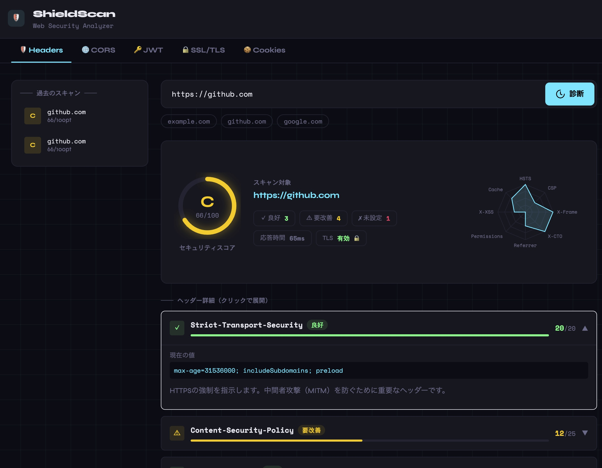

# ShieldScan

[English](README.md) | [日本語](README.ja.md)

URLのHTTPレスポンスヘッダーを解析し、セキュリティスコアとグレードを算出するWebツールです。  
セキュリティヘッダーの評価に加え、CORS・JWT・SSL/TLS・Cookieの診断機能を備えています。



---

## 機能

| タブ | 概要 |
|---|---|
| **Security Headers** | 8種類のセキュリティヘッダーをスコアリングし、A+〜Fのグレードを算出 |
| **CORS Scan** | CORSミスコンフィグ（オリジン反射・Nullオリジン・ドメイン前後一致）を診断 |
| **JWT Analyzer** | JWTトークンを静的解析（alg:none・kid インジェクション・有効期限・機密情報の混入）|
| **SSL/TLS Check** | TLSバージョン・暗号スイート・証明書の有効期限・ホスト名一致を検査 |
| **Cookie Audit** | Secure・HttpOnly・SameSite フラグの設定状況を監査 |

その他:
- レーダーチャートによるヘッダースコアの可視化
- 各問題点に対する改善アドバイス
- 日本語・英語の表示切り替え
- スキャン履歴（直近50件、新しい順）

## 表示言語

日本語と英語に対応しています。初回表示時はブラウザの言語設定から判定し、日本語以外は英語になります。
画面右上のトグル（EN / JA）で切り替えられ、選択内容は `localStorage` に保存されます。

診断結果の文言はバックエンドが訳文ではなく翻訳キーと差し込みパラメータを返し、フロントエンドの辞書で解決します。
このため言語を切り替えると、保存済みのスキャン履歴の表示も切り替わります。

辞書は `frontend/src/i18n/locales/` にあります。メッセージを追加・変更するときは次の3点をそろえてください。

- `backend/internal/msg/keys.go` のキー定数と `AllKeys`
- `frontend/src/i18n/locales/ja.json`
- `frontend/src/i18n/locales/en.json`

`go test ./internal/msg/` がキーの過不足とプレースホルダの不一致を検出します。

## Tech Stack

- **Backend**: Go
- **Frontend**: React + Vite + Tailwind CSS + Recharts
- **インフラ**: Docker / Docker Compose

## クイックスタート

### Docker Compose（推奨）

```bash
git clone https://github.com/nobuo-miura/ShieldScan
cd ShieldScan
docker compose up --build
```

ブラウザで `http://localhost:3000` にアクセスしてください。

### ローカル開発

```bash
# Backend（ポート 8080）
cd backend
go run ./cmd/server

# Frontend（別ターミナル、ポート 5173）
cd frontend
npm install
npm run dev
```

フロントエンドの `/api` リクエストは Vite の開発プロキシ経由でバックエンドに転送されます。

## 設定

| 環境変数 | 既定値 | 説明 |
|---|---|---|
| `PORT` | `8080` | バックエンドのリッスンポート。数値以外を指定すると起動時にエラーで停止します。 |
| `SHIELDSCAN_ALLOW_PRIVATE` | 無効 | プライベート・ループバックアドレスへのスキャンを許可します。**SSRF防御が無効になるため、ローカル開発専用です。** |
| `SHIELDSCAN_TRUST_PROXY` | 無効 | クライアント識別に `X-Forwarded-For` を使用します。このヘッダーを上書きするリバースプロキシ配下でのみ有効にしてください。 |

ローカルで動かしているサービスをスキャンしたい場合:

```bash
(cd backend && SHIELDSCAN_ALLOW_PRIVATE=true go run ./cmd/server)
```

公開インスタンスでこれを設定すると、誰でもあなたのサーバー経由で内部ネットワークに到達できます。詳細は [SECURITY.md](SECURITY.md) を参照してください。

## セキュリティ

ShieldScan はユーザーが指定した任意のURLへサーバー側からリクエストを送るため、SSRF が構造上の最大リスクです。外向きのTCP接続はすべて、接続直前に実際の解決済みIPを検査するフックを通ります（DNS rebinding やリダイレクト経由の迂回にも対応）。

一方で **認証機構はなく、スキャン履歴は全利用者で共有** されます。インターネットに公開する場合は [SECURITY.md](SECURITY.md) を必ず読んでください。

スキャンは実際にリクエストを送信します。自分が所有しているか、明示的な許可を得たシステムのみを対象にしてください。

## 開発

リポジトリ直下から実行してください。サブシェルを使っているので、実行後もカレントディレクトリは変わりません。

```bash
(cd backend && gofmt -l . && go vet ./... && go test -race ./... && golangci-lint run ./...)
(cd frontend && npm run lint && npm run build)
```

貢献方法は [CONTRIBUTING.md](CONTRIBUTING.md) を参照してください。

## API

ベースURLは実行方法によって変わります。

- **Docker Compose** — `http://localhost:3000/api/...`（nginx がプロキシ）。バックエンドコンテナはホストに公開していません。レート制限がプロキシのクライアントIPヘッダーを信頼できるようにするための意図的な構成です。
- **ローカル開発** — `http://localhost:8080/api/...` に直接アクセス。

### POST /api/analyze — セキュリティヘッダー診断

```json
// Request
{ "url": "https://example.com" }

// Response
{
  "url": "https://example.com",
  "final_url": "https://example.com/",
  "total_score": 75,
  "max_score": 100,
  "grade": "B",
  "tls_enabled": true,
  "response_time_ms": 312,
  "headers": [
    {
      "name": "Strict-Transport-Security",
      "present": true,
      "value": "max-age=31536000; includeSubDomains",
      "score": 15,
      "max_score": 20,
      "status": "warning",
      "description": { "key": "analyzer.header.hsts.desc" },
      "advice": { "key": "analyzer.header.hsts.advice.no_preload" }
    }
  ]
}
```

`description` や `advice` などの説明文は、訳文ではなく翻訳キー（と必要に応じて `params`）で返します。

```json
{ "key": "analyzer.ssl.finding.cert_valid.title", "params": { "count": 57 } }
```

対応する訳文は `frontend/src/i18n/locales/` にあります。改善点がない場合、`advice` は省略されます。

エラー応答も同じ形式です。

```json
// 400 Bad Request
{ "error": { "key": "api.error.blocked_address", "params": { "ip": "169.254.169.254" } } }
```

### POST /api/cors — CORS診断

```json
// Request
{ "url": "https://example.com" }
```

### POST /api/jwt — JWT解析

```json
// Request
{ "token": "<JWT文字列>" }
```

### POST /api/ssl — SSL/TLS診断

```json
// Request
{ "host": "example.com", "port": "443" }
// port は省略可（デフォルト: 443）
```

### POST /api/cookies — Cookie監査

```json
// Request
{ "url": "https://example.com" }
```

### GET /api/history — スキャン履歴

直近50件を新しい順で返します。

### GET /health — ヘルスチェック

```json
{ "status": "ok" }
```

## ディレクトリ構成

```
shieldscan/
├── backend/
│   ├── cmd/server/         # エントリーポイント
│   └── internal/
│       ├── analyzer/       # 各種スキャンロジック
│       │   ├── analyzer.go # セキュリティヘッダー評価
│       │   ├── cors.go     # CORS診断
│       │   ├── jwt.go      # JWT解析
│       │   ├── ssl.go      # SSL/TLS診断
│       │   └── cookie.go   # Cookie監査
│       ├── handlers/       # HTTPハンドラー・レート制限
│       ├── msg/            # 診断メッセージの翻訳キー定義
│       ├── safehttp/       # SSRF耐性のあるHTTPクライアント・ダイヤラー
│       └── models/         # インメモリ履歴ストア
├── frontend/
│   └── src/
│       ├── components/     # 各診断タブのUIコンポーネント
│       └── i18n/           # 翻訳関数と辞書（locales/ja.json・en.json）
└── docker-compose.yml
```

外向きのリクエストはすべて `internal/safehttp` を経由します。スキャナ内で素の `http.Client` を作らないでください。SSRF防御が外れます。

## License

MIT
